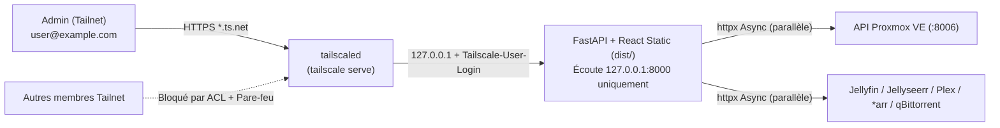

# PVE Command Center

Un **panel d'administration homelab moderne, léger et ultra-sécurisé** conçu pour centraliser la supervision de **Proxmox VE**, des disques physiques & pools de stockage (MergerFS / LVM / SMART), des services multimédias (`*arr`, Jellyfin, Plex, qBittorrent) et la gestion unifiée des utilisateurs, protégé nativement par **Tailscale Serve SSO**.

---

## Architecture & Sécurité



- **Aucun mot de passe exposé / Zéro login HTML** : le middleware [tailscale_auth.py](backend/app/middleware/tailscale_auth.py) exige que la connexion TCP provienne strictement de `127.0.0.1` / `::1` (`--no-proxy-headers` activé sur Uvicorn) et valide `Tailscale-User-Login` contre `ALLOWED_TAILSCALE_USERS`.
- **Conteneur unique léger** : build multi-stage Docker (`node:22-alpine` → `python:3.12-slim`). En production, seul Python/FastAPI tourne et sert les fichiers statiques React compilés.
- **Asynchronisme complet** : toutes les requêtes vers Proxmox et les services s'exécutent en parallèle via `httpx.AsyncClient` et `asyncio.gather`.

---

## Fonctionnalités

1. **Supervision & Contrôle Proxmox VE :**
   - Jauge CPU, charge système, RAM, Swap, RootFS et Uptime du nœud.
   - Liste complète des VMs et conteneurs LXC avec filtres, consommation en direct et actions rapides (**Démarrer / Redémarrer / Arrêter**) protégées par modale de confirmation et verrou anti-auto-arrêt (`PANEL_SELF_VMID`).
2. **Onglet Stockage & Disques (Interne & Externe / MergerFS) :**
   - Vue du pool global MergerFS (ex. `/mnt/pool_medias`), des pools Proxmox (`local-lvm`, `local`, `pve-root`) et de chaque disque dur physique (`/mnt/*`) avec **état S.M.A.R.T.**, modèle, S/N, RPM et taux d'occupation en temps réel.
   - Découverte dynamique des sous-dossiers montés dans `/host_mnt` (avec étiquettes/WWN personnalisables dans `services.yaml`).
3. **Hub de Services & Widgets en direct :**
   - Déclaration dynamique dans `services.yaml` (sans recompiler l'image).
   - Healthchecks HTTP parallèles avec latence (`ms`) et widgets temps réel pour **Jellyfin**, **Plex**, **Radarr**, **Sonarr**, **Prowlarr** et **qBittorrent**.
4. **Onglet Activité & Actions + Alertes Intelligentes :**
   - **Bannière d'alertes automatique** : disques ≥ 90 %, pools Proxmox ≥ 80 %, services hors ligne, demandes Jellyseerr en attente, comptes non synchronisés.
   - **Demandes Jellyseerr** : approuver ou refuser les demandes en 1 clic.
   - **Contrôle qBittorrent** : bascule 1 clic du **Mode Vitesse Alternative (Mode Tortue)** + pause / reprise des torrents récents.
   - **Scans Médias & Tâches PVE** : déclenchement du scan **Jellyfin** / **Plex** et journal des dernières tâches Proxmox.
5. **Gestion unifiée des utilisateurs Jellyfin ↔ Jellyseerr :**
   - Création d'un compte Jellyfin avec réplication immédiate dans Jellyseerr.
   - Édition complète : suspendre/réactiver un compte, limiter le nombre d'écrans simultanés, autoriser/interdire les téléchargements hors-ligne, restreindre l'accès par médiathèque, basculer entre **Auto-approuvé** et **Validation manuelle** sur Jellyseerr, réinitialiser le mot de passe ou supprimer le compte synchronisé *(le compte désigné par `PROTECTED_OWNER_USERNAME` reste verrouillé côté backend)*.
6. **Application Apple Native (iOS & macOS) en Swift 6 / SwiftUI + Interface PWA Liquid Glass :**
   - Application **100 % native macOS & iPhone / iPad** (`ios-native/PVECenter.xcodeproj`) : barre latérale `NavigationSplitView` et **MenuBarExtra** sur Mac (raccourcis `⌘R`, `⌘L`, `⌘1`–`⌘6`, `⌘,`), `TabView` et haptique Taptic Engine sur iPhone, **Swift Charts**, `.ultraThinMaterial` Light & Dark Mode et acteur `DemoDataStore`.
   - Compilation directe du bundle Mac signé via `./ios-native/build-macos-app.sh` -> `PVE Center.app`.
   - Surfaces Web **Liquid Glass** (`.liquid-glass`, `.liquid-glass-elevated`, barre de navigation flottante iPhone `.liquid-glass-dock`, modales `.ios-sheet`, gestion des `env(safe-area-inset-*)`).
   - Guide complet App Store / macOS dans [APPSTORE.md](APPSTORE.md).

---

## Installation & Déploiement

### 1. Préparer la configuration
```bash
git clone <url-de-votre-depot> pve-panel
cd pve-panel
cp .env.example .env
cp services.example.yaml services.yaml
```
Adaptez `.env` et `services.yaml` à votre infrastructure. *(Les deux fichiers sont ignorés par `.gitignore` pour ne jamais publier vos secrets).*

### 2. Créer un Token API Proxmox à privilèges restreints
Sur votre hôte Proxmox VE :
```bash
pveum role add PanelRole -privs "Sys.Audit VM.Audit Datastore.Audit VM.PowerMgmt"
pveum user token add root@pam pve-panel --privsep 1 --output-format json
pveum acl modify / -tokens "root@pam!pve-panel" -roles PanelRole
```
Reportez `PVE_TOKEN_ID=root@pam!pve-panel` et `PVE_TOKEN_SECRET=<secret>` dans `.env`.

### 3. Montage des disques externes (LXC Proxmox ou Docker)
Dans un conteneur LXC Proxmox dédié, exposez `/mnt` en lecture seule récursive :
```text
# /etc/pve/lxc/<VMID>.conf
lxc.mount.entry: /mnt host_mnt none rbind,ro,create=dir 0 0
```
*(Si vous déployez directement sur l'hôte Linux sans LXC, remplacez `- /host_mnt:/host_mnt:ro` par `- /mnt:/host_mnt:ro` dans `docker-compose.yml`).*

### 4. Lancement en production avec Docker & Tailscale Serve
Assurez-vous que `DEV_AUTH_BYPASS=false` dans `.env` :
```bash
docker compose up -d --build
tailscale up --advertise-tags=tag:panel --hostname=pve-panel
tailscale serve --bg http://127.0.0.1:8000
```

#### Exemple de règle ACL Tailscale (Isolation stricte)
```json
{
  "tagOwners": {
    "tag:panel": ["user@example.com"]
  },
  "acls": [
    {
      "action": "accept",
      "src": ["user@example.com"],
      "dst": ["tag:panel:*"]
    }
  ]
}
```

### Développement local (avec `DEV_AUTH_BYPASS=true`)
```bash
# 1. Build frontend
cd frontend && npm install && npm run build && cd ..

# 2. Backend Python 3.12
python3.12 -m venv .venv
source .venv/bin/activate
pip install -r backend/requirements.txt
cd backend && uvicorn app.main:app --host 127.0.0.1 --port 8000
```
Accédez à `http://127.0.0.1:8000`.

---

## Licence
Distribué sous licence [MIT](LICENSE).
