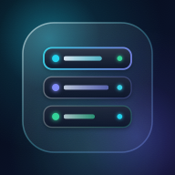
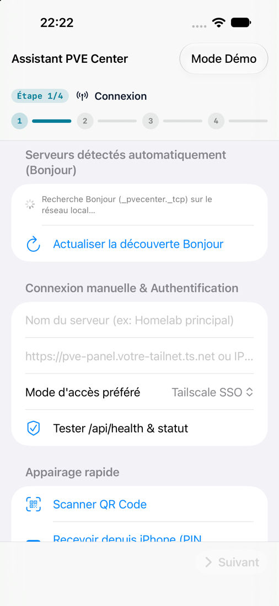
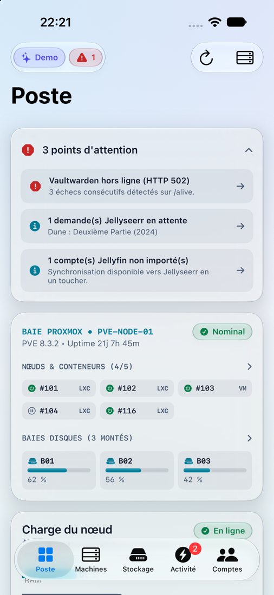
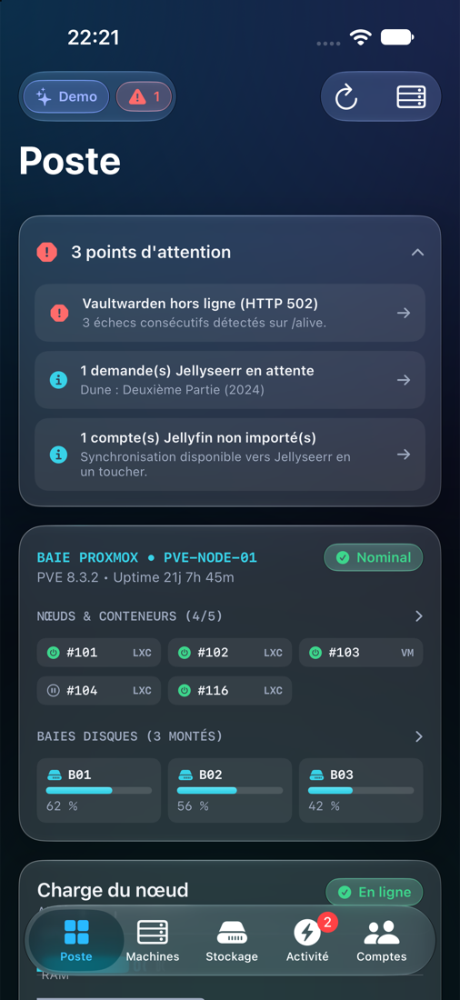
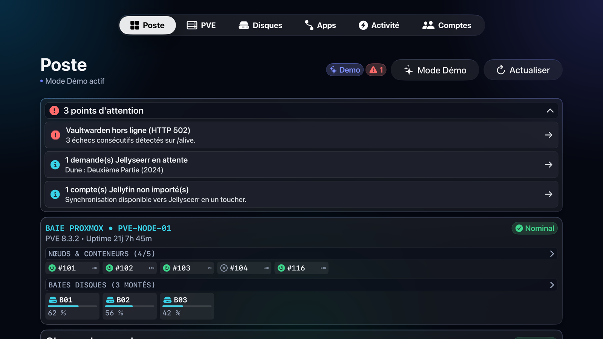
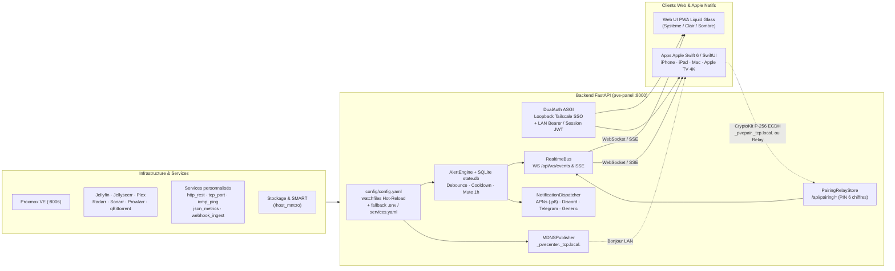

<div align="center">
  
  <h1>PVE Command Center</h1>
  <p>
    <strong>Cockpit temps réel pour Proxmox VE, stockage SMART/MergerFS, services homelab et alertes multi-canaux.</strong><br />
    Backend FastAPI déclaratif &nbsp;•&nbsp; Interface Web PWA Liquid Glass &nbsp;•&nbsp; App Apple native Swift 6 (iOS, macOS, tvOS 27)
  </p>

  <p>
    
    
    
    
    
    <a href="LICENSE"></a>
  </p>

  <p>
    <a href="#-aperçu-multi-plateformes">Aperçu</a> &nbsp;·&nbsp;
    <a href="#-démarrage-rapide">Démarrage rapide</a> &nbsp;·&nbsp;
    <a href="#-architecture--sécurité">Architecture</a> &nbsp;·&nbsp;
    <a href="#%EF%B8%8F-configuration-déclarative-configyaml">config.yaml</a> &nbsp;·&nbsp;
    <a href="#-services-personnalisés--alertes">Alertes & Webhooks</a> &nbsp;·&nbsp;
    <a href="#-applications-apple--tests">Apps Apple & Tests</a>
  </p>
</div>

---

## ✨ Points forts

- **Pilotez tout votre homelab au même endroit** : supervision du nœud Proxmox VE (CPU, RAM, rootfs, démarrage/arrêt/redémarrage de LXC et VMs avec garde-fou anti-auto-arrêt `panel_self_vmid`), pools **MergerFS**, santé **SMART** des disques (`/host_mnt:ro`), services `*arr` / **Jellyfin** / **Plex** / **Jellyseerr** / **qBittorrent** et synchronisation de comptes utilisateurs.
- **Configuration déclarative `config.yaml` & Hot-Reload** : toute la configuration vit dans `./config/config.yaml` avec interpolation `${VAR_NAME}` pour les secrets, validation Pydantic, repli automatique depuis `.env` + `services.yaml`, écriture atomique, surveillance temps réel via `watchfiles` et diffusion instantanée sur **WebSocket** / **SSE**.
- **Zéro-config LAN avec Bonjour/mDNS, QR Code & Appairage PIN chiffré** : publication `_pvecenter._tcp.local.`, scan automatique LAN (`_http._tcp`, `_ssh._tcp`, `_smb._tcp`), assistant d'installation en **4 étapes**, QR Code `pvecenter://` généré côté Web et transfert chiffré de configuration **iPhone → Apple TV** par code **PIN à 6 chiffres** (`CryptoKit` P-256 ECDH + `HKDF-SHA256` + `AES-GCM`).
- **Moteur d'alertes SQLite & Notifications multi-canaux** : 5 connecteurs extensibles (`http_rest`, `tcp_port`, `icmp_ping`, `json_metrics`, `webhook_ingest`), *debouncing* (`consecutive_failures`), *cooldown* anti-spam, reprise automatique `DOWN → UP`, `Acquitter` / `Mute 1h`, webhooks **Discord**, **Telegram**, **ntfy/Gotify/Home Assistant** et support **APNs HTTP/2 (`.p8`)**.
- **UI Liquid Glass adaptative Clair / Sombre** : Web PWA React 19 + application **100 % native Swift 6** (iPhone, iPad, Mac et Apple TV 4K avec `SwiftData`, `Keychain`, `Swift Charts`, Focus Engine tvOS et Mode Démo complet).

---

## 📱 Aperçu multi-plateformes

<table>
  <tr>
    <td align="center" width="33%">
      <br />
      <sub><strong>Onboarding 4 étapes (iOS)</strong><br />Bonjour, QR Code, Token & Quick-Add</sub>
    </td>
    <td align="center" width="33%">
      <br />
      <sub><strong>Vue Poste — Mode Clair</strong><br />Liquid Glass, Alertes & Baie Proxmox</sub>
    </td>
    <td align="center" width="33%">
      <br />
      <sub><strong>Vue Poste — Mode Sombre</strong><br />Thème Obsidian & Indicateurs live</sub>
    </td>
  </tr>
</table>

<div align="center">
  <br />
  <sub><strong>Apple TV 4K (tvOS 27)</strong> — Focus Engine natif, bannières d'alertes temps réel WebSocket et appairage PIN depuis l'iPhone.</sub>
</div>

---

## ⚡ Démarrage rapide

### Option 1 — Installation automatisée (`install.sh`)

```bash
git clone https://github.com/Fairy-Jeux/pve-panel.git pve-panel
cd pve-panel
chmod +x install.sh
sudo ./install.sh
```

> Le script détecte automatiquement votre environnement :
> - **Mode A (Hôte Proxmox VE via `pveversion`)** : crée un conteneur LXC Debian 12 non privilégié, configure le rôle `PanelRole` et son token `root@pam!pve-panel`, monte `/mnt` en lecture seule (`/host_mnt`), génère un `SESSION_SECRET`, initialise `config/config.yaml` et déploie Docker + Tailscale Serve.
> - **Mode B (Serveur Linux ou LXC existant)** : installe Docker Engine / Compose et Tailscale si nécessaires, prépare `./config:/app/config:rw`, lance la stack et configure `tailscale serve --bg http://127.0.0.1:8000`.
>
> Flags disponibles : `--in-container`, `--ts-hostname <nom>`, `--allowed-users <emails>`, `--pve-node <noeud>`.

### Option 2 — Docker Compose (manuel)

```bash
git clone https://github.com/Fairy-Jeux/pve-panel.git pve-panel
cd pve-panel
mkdir -p config
cp config/config.example.yaml config/config.yaml
cp .env.example .env
cp services.example.yaml services.yaml
docker compose up -d --build
```

Ensuite, ouvrez l'interface Web (ou l'app Apple) : au premier démarrage (`is_configured == false`), l'assistant **Onboarding en 4 étapes** vous guide pour sécuriser votre accès et créer votre premier jeton API.

<details>
<summary><strong>Options réseau Docker (`host` vs `bridge` + Avahi), ACL Tailscale et développement local</strong></summary>

#### Pourquoi `network_mode: host` est activé par défaut dans `docker-compose.yml`
1. **Bonjour / mDNS natif (`_pvecenter._tcp.local.`)** : la diffusion multicast `224.0.0.251:5353` et le scan LAN (`GET /api/discovery/lan`) fonctionnent directement sur l'interface de l'hôte.
2. **Authentification DualAuth exacte** : avec `--no-proxy-headers`, le trafic HTTPS de `tailscale serve` sur l'hôte arrive sur `127.0.0.1` avec l'en-tête `Tailscale-User-Login`, tandis que les clients LAN / Apple passent par jeton `Bearer`.

#### Passer en mode `bridge` avec Avahi / D-Bus (optionnel)
Décommentez les ports et volumes D-Bus/Avahi dans [`docker-compose.yml`](docker-compose.yml) (nécessite `avahi-daemon` sur l'hôte) :

```yaml
services:
  pve-panel:
    build:
      context: .
      dockerfile: Dockerfile
    container_name: pve-panel
    restart: unless-stopped
    ports:
      - "${LISTEN_PORT:-8000}:8000"
    environment:
      - CONFIG_PATH=/app/config/config.yaml
      - STATE_DB_PATH=/app/config/state.db
      - LISTEN_HOST=0.0.0.0
      - LISTEN_PORT=8000
    volumes:
      - ./config:/app/config:rw
      - /host_mnt:/host_mnt:ro
      - /var/run/dbus:/var/run/dbus
      - /var/run/avahi-daemon/socket:/var/run/avahi-daemon/socket
```

> En mode `bridge`, Tailscale Serve arrive via la passerelle Docker (`172.17.0.1`) et non `127.0.0.1` : authentifiez vos clients via **Bearer API Token / PIN** (`/api/auth/login`) ou partagez le namespace réseau d'un conteneur Tailscale.

#### Exemple d'ACL Tailscale
```json
{
  "tagOwners": { "tag:panel": ["admin@example.com"] },
  "acls": [
    { "action": "accept", "src": ["admin@example.com"], "dst": ["tag:panel:*"] }
  ]
}
```

#### Développement local (`DEV_AUTH_BYPASS=true`)
```bash
# Frontend React / Vite
cd frontend && npm ci && npm run build && cd ..

# Backend FastAPI Python 3.12
python3.12 -m venv .venv
source .venv/bin/activate
pip install -r backend/requirements.txt
DEV_AUTH_BYPASS=true uvicorn app.main:app --app-dir backend --host 127.0.0.1 --port 8000
```

</details>

---

## 🏗️ Architecture & Sécurité



### Modèle de sécurité DualAuth ([`tailscale_auth.py`](backend/app/middleware/tailscale_auth.py))

| Origine client | Mécanisme vérifié | Usage typique |
|---|---|---|
| **Loopback** (`127.0.0.1` / `::1`) | `Tailscale-User-Login` (contre `security.allowed_tailscale_users`), ou `Bearer` token, ou `dev_auth_bypass: true` | Tailscale Serve HTTPS (`*.ts.net`), développement local |
| **LAN / mDNS / WebSocket / SSE** | `Authorization: Bearer <token>` (ou `?token=` pour WS/SSE), comparé en temps constant contre les hash SHA-256 `security.api_tokens` ou JWT HS256 issu de `POST /api/auth/login` | iPhone, iPad, Mac, Apple TV, navigateurs sur le réseau local |
| **Routes publiques cadrées** | `/api/health`, `/api/auth/login`, `/api/pairing/*` (protégé par PIN + anti brute-force), `/api/onboarding/status`, `POST /api/custom-services/{id}/webhook` | Découverte, appairage, webhooks entrants ; l'onboarding initial est verrouillé (`401`) dès que `is_configured == true` |

<details>
<summary><strong>Arborescence du dépôt</strong></summary>

```text
pve-panel/
├── backend/
│   ├── app/
│   │   ├── config_schema.py          # Modèles Pydantic v2 pour config.yaml
│   │   ├── config_manager.py         # Interpolation ${VAR}, écriture atomique, watchfiles, fallback .env
│   │   ├── middleware/tailscale_auth.py
│   │   ├── routers/                  # auth, config_yaml, custom_services, discovery, incidents,
│   │   │                             # notifications, operations, pairing, proxmox, services, setup, users, widgets
│   │   └── services/
│   │       ├── connectors/           # http_rest, tcp_port, icmp_ping, json_metrics, webhook_ingest
│   │       ├── alert_engine.py       # Boucle asynchrone, debounce, cooldown, recovery
│   │       ├── state_store.py        # SQLite state.db (états, incidents, mute, device tokens)
│   │       ├── mdns_publisher.py     # Annonce _pvecenter._tcp.local. & scan LAN Zeroconf
│   │       ├── notifications.py      # APNs HTTP/2 .p8, Discord, Telegram MarkdownV2, Webhook générique
│   │       ├── pairing_relay.py      # Sessions PIN 6 chiffres pour appairage chiffré
│   │       └── realtime_bus.py       # Pub/Sub asynchrone WebSocket & SSE
│   └── tests/                        # 21 tests pytest (config, auth, connecteurs, alertes, notifications, pairing)
├── config/
│   └── config.example.yaml           # Modèle complet commenté (config/config.yaml & *.db ignorés par git)
├── frontend/                         # React 19, Vite, Tailwind, Liquid Glass Clair/Sombre, Éditeur YAML, QR SVG
├── ios-native/                       # Projet Xcode unique Swift 6 (iOS, macOS, tvOS 27) + Package.swift + scripts
├── docs/screenshots/                 # Captures d'écran de référence (Mode Démo)
├── Dockerfile                        # Multi-stage node:22-alpine -> python:3.12-slim (avec iputils-ping)
├── docker-compose.yml                # Montage ./config:/app/config:rw et network_mode: host
├── install.sh                        # Installateur Proxmox VE LXC & Linux/Docker
└── APPSTORE.md                       # Guide complet Xcode, permissions Bonjour/Caméra, APNs .p8 & sideloading
```

</details>

---

## ⚙️ Configuration déclarative (`config.yaml`)

Le fichier modèle [`config/config.example.yaml`](config/config.example.yaml) documente l'ensemble des sections. Copiez-le vers `config/config.yaml` (exclu de Git via `.gitignore`) ou laissez l'assistant d'onboarding le générer.

- **Secrets via `${VAR_NAME}` / `${VAR_NAME:-default}`** : les variables sont résolues au chargement depuis `os.environ` et `.env` ; les éditions depuis l'interface Web ou Apple **préservent intactes** vos références `${VAR_NAME}` et secrets existants.
- **Éditeur YAML & Validation en direct** : inspectez, validez (`POST /api/config/validate`), importez/exportez et rechargez à chaud (`PUT /api/config/yaml`) directement depuis les paramètres Web ou Apple.
- **Repli transparent** : tant que `config/config.yaml` est absent, les installations existantes sous `.env` + `services.yaml` restent 100 % compatibles.

<details>
<summary><strong>Aperçu des sections de `config/config.yaml`</strong></summary>

| Section | Rôle | Options principales |
|---|---|---|
| `version` | Version du schéma | `1` |
| `server` | Réseau & Bonjour | `id`, `name`, `listen_host`, `listen_port`, `public_url`, `mdns_enabled`, `mdns_service_type` (`_pvecenter._tcp.local.`), `refresh_interval_seconds` |
| `security` | DualAuth & jetons | `tailscale_sso_enabled`, `allowed_tailscale_users`, `dev_auth_bypass`, `protected_owner_username`, `session_secret`, `admin_pin_hash`, `api_tokens` |
| `proxmox` | Hyperviseur PVE | `host`, `token_id`, `token_secret`, `verify_ssl`, `default_node`, `panel_self_vmid` |
| `integrations` | Applications homelab | `jellyfin`, `jellyseerr`, `plex`, `radarr`, `sonarr`, `prowlarr`, `qbittorrent` |
| `alerts` | Règles globales | `enabled`, `default_consecutive_failures`, `default_cooldown_seconds`, `check_interval_seconds` |
| `notifications` | APNs & Webhooks | `apns` (`team_id`, `key_id`, `bundle_id`, `private_key_path`, `use_sandbox`) et `webhooks` (`discord`, `telegram`, `generic`) |
| `categories` | Tuiles héritées | Catégories et widgets (`jellyfin`, `plex`, `radarr`, `sonarr`, `prowlarr`, `qbittorrent`) |
| `custom_services` | Services supervisés | `protocol`, `host`, `port`, `url`, `health_url`, `auth_type`, `json_metric_path`, `order`, `alert_policy` |
| `storage_mounts` | Stockage / SMART | `mount`, `subpath`, `wwn`, `label` |

</details>

---

## 🔔 Services personnalisés & Alertes

### Connecteurs disponibles (`/api/custom-services`)

| Protocole | Type de contrôle | Paramètres clés |
|---|---|---|
| `http_rest` | Requête HTTP/HTTPS (`GET`/`HEAD`) | `url` / `health_url` / `internal_url`, `expected_status`, `verify_ssl`, auth `none`/`bearer`/`basic`/`header` |
| `tcp_port` | Connexion socket TCP + latence | `host`, `port` |
| `icmp_ping` | Ping ICMP monocoup (`ping -c 1`) + RTT | `host` |
| `json_metrics` | Fetch JSON + extraction de métriques | `url` / `health_url`, `json_metric_path` (ex. `running,version`, `stats.active_users`) |
| `webhook_ingest` | Push heartbeat entrant + TTL | `POST /api/custom-services/{id}/webhook`, `webhook_ttl_seconds`, `auth_token` |

### AlertEngine, Incidents & Notifications (`/api/incidents`, `/api/notifications`)

1. **Anti-faux positifs & Reprise** : chaque service attend `consecutive_failures` échecs avant de passer `down` et d'enregistrer un incident dans SQLite (`STATE_DB_PATH=/app/config/state.db`), respecte `cooldown_seconds`, détecte automatiquement `DOWN → UP`, et supporte `Acquitter` + **`Mute 1h`**.
2. **Webhooks prêts à l'emploi + bouton « Tester »** :
   - **Discord** : Rich Embeds colorés (`#EF4444` panne, `#F59E0B` dégradé, `#10B981` rétablissement).
   - **Telegram** : Bot API `sendMessage` échappé `MarkdownV2` (`bot_token` + `chat_id`).
   - **Générique (ntfy / Gotify / Home Assistant)** : payload JSON structuré + en-têtes personnalisés (`headers`).
3. **Notifications Apple (APNs `.p8` optionnel)** :
   - **Opérationnel immédiatement sans clé `.p8`** : notifications locales interactives sur iOS/macOS (`Mute 1h`, `Tester`) et bannières d'alerte temps réel sur Apple TV alimentées par WebSocket/SSE.
   - **Push en arrière-plan (avec compte Apple Developer Program)** : déposez votre fichier `AuthKey.p8` dans `./config/AuthKey.p8`, activez `notifications.apns.enabled: true` (`team_id`, `key_id`), et consultez [APPSTORE.md](APPSTORE.md) pour la capability Push.

---

## 📱 Applications Apple & Tests

### Découverte & Appairage iPhone → Apple TV (PIN 6 chiffres)

1. Sur **Apple TV**, lancez l'app ou ouvrez *Appairer depuis iPhone* : `PairingCryptoService` génère une paire de clés éphémères **CryptoKit P-256 ECDH** et affiche un **code PIN à 6 chiffres** (valide 5 min) annoncé via Bonjour (`_pvepair._tcp.local.`) et/ou le relais serveur (`/api/pairing/sessions`).
2. Sur **iPhone** (connecté via Bonjour `_pvecenter._tcp.local.` ou QR Code `pvecenter://`), sélectionnez l'Apple TV et saisissez le PIN : les identifiants (nom, URL, Bearer API Token) sont chiffrés en **AES-256-GCM** avec une clé dérivée par **ECDH + HKDF-SHA256** et transférés de bout en bout sans rien taper à la télécommande.

### Commandes Apple, Tests & Vérifications

```bash
# Lancer sur simulateur iPhone ou Apple TV
./ios-native/run-iphone-sim.sh
./ios-native/run-appletv-sim.sh

# Installer l'application macOS dans /Applications/PVE Center.app (ou via SwiftPM)
./ios-native/install-mac.sh
./ios-native/build-macos-app.sh

# Déployer sur un appareil physique iOS / tvOS
./ios-native/deploy-device.sh --list
./ios-native/deploy-device.sh -t <TEAM_ID> -p ios   # ou -p tvos
```

```bash
# Backend Python (compilation + 21 tests pytest)
cd backend && ../.venv/bin/python -m compileall -q app && ../.venv/bin/python -m pytest -v

# Frontend React / TypeScript
cd frontend && npm ci && npx tsc --noEmit && npm run build

# Package Swift 6 (macOS) & Vérification installeur
cd ios-native && swift build
bash -n install.sh && plutil -lint ios-native/PVECenter/Resources/Info.plist
```

---

## 📚 Documentation & Licence

- 📖 [APPSTORE.md](APPSTORE.md) — Guide Xcode 27 / Swift 6, permissions Bonjour/Caméra, activation APNs `.p8`, TestFlight et sideloading (**AltStore / SideStore / Sideloadly**)
- 📝 [config/config.example.yaml](config/config.example.yaml) — Référence YAML complète
- 🐳 [docker-compose.yml](docker-compose.yml) · [Dockerfile](Dockerfile) · [install.sh](install.sh)

Distribué sous licence [MIT](LICENSE).
