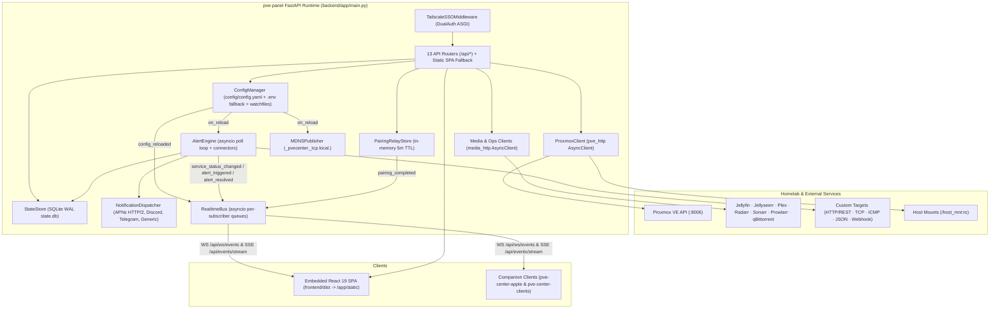

[English](architecture.md) | [Français](../fr/architecture.md)

# Architecture Overview

`pve-panel` is a single-container **FastAPI + React 19** homelab command center designed for Proxmox VE nodes, MergerFS/SMART storage pools, media automation services, stateful service alerting, and encrypted companion-app onboarding.

---

## 1. High-Level System Architecture

---

## 2. Backend Lifespan & HTTP Clients

In `backend/app/main.py`, the FastAPI `lifespan` initializes:

1. **`RealtimeBus`**: Binds to the active `asyncio` event loop for pub/sub fan-out (`max_queue_size = 128`, drop-oldest on overflow).
2. **Async HTTP Pools (`httpx.AsyncClient`)**:
   - `app.state.pve_http`: Uses `cfg.proxmox.verify_ssl` and `timeout=httpx.Timeout(5.0, connect=3.0)`. Recreated cleanly whenever `proxmox.verify_ssl` changes via `PUT /api/config/yaml`, `POST /api/onboarding/init`, or `PUT /api/setup/config`.
   - `app.state.media_http`: Uses `verify=False` and `timeout=httpx.Timeout(3.5, connect=2.5)` for internal homelab media services, connectors, and outbound webhooks.
3. **`StateStore`**: Opens SQLite (`STATE_DB_PATH`, defaulting to `/app/config/state.db` in Docker) with `WAL` journal mode, `PRAGMA synchronous=NORMAL`, and `PRAGMA foreign_keys=ON`.
4. **`PairingRelayStore`**, **`NotificationDispatcher`**, **`MDNSPublisher`**, and **`AlertEngine`**.
5. **`ConfigManager` watcher**: Starts a `watchfiles.awatch` task monitoring `config/config.yaml` (and `.env` / `services.yaml` when running in synthesized legacy mode).

FastAPI serves the compiled React 19 frontend from `STATIC_DIR` (`/app/static` inside Docker, or `frontend/dist` locally). HTML files are served with `Cache-Control: no-store, no-cache, must-revalidate, max-age=0` so deployments never leave stale UI bundles cached.

---

## 3. Declarative ConfigManager & Secret Preservation

Implemented in `backend/app/config_manager.py` and `backend/app/config_schema.py`:

- **Resolution Order**:
  - `CONFIG_PATH` env var -> `/app/config/config.yaml` (if present or `/app` exists) -> `./config/config.yaml`.
  - If `config.yaml` does not exist, `ConfigManager` synthesizes an in-memory `AppConfig` from `.env` / `os.environ` and `services.yaml` (`is_synthesized == True`), polling `mtime` stamps to detect external updates seamlessly.
- **Environment Variable Interpolation**:
  - Strings containing `${VAR_NAME}` or `${VAR_NAME:-default}` are resolved recursively against `.env` + `os.environ` (`os.environ` takes precedence).
- **Secret Masking & Template Preservation**:
  - `GET /api/config/yaml` and `GET /api/config/export` mask literal secrets with `"********"` while keeping `${VAR_NAME}` placeholders visible.
  - `PUT /api/config/yaml`, `PUT /api/setup/config`, and `PUT /api/notifications/channels` preserve existing `${VAR_NAME}` expressions and stored secrets whenever `"********"` or empty values are sent.
- **Atomic Writes**:
  - `write_text_safe` writes to a hidden temporary file in the target directory, `fsync`s, preserves permissions (`0600` for newly created `.env` and `config.yaml`), and `os.replace`s — automatically falling back to in-place `fsync` writes if a Docker bind mount raises `EBUSY`, `EXDEV`, or `EPERM`.

---

## 4. DualAuth Security Architecture

`TailscaleSSOMiddleware` (`backend/app/middleware/tailscale_auth.py`) runs as a pure ASGI middleware supporting HTTP, SSE `StreamingResponse`, and WebSockets:

1. **Bearer Token or Query Token Extraction**:
   - Reads `Authorization: Bearer <token>` on all HTTP/WS requests.
   - For WebSockets (`scope["type"] == "websocket"` or `/api/ws/*`) and SSE (`/api/events/stream`), also accepts `?token=<token>`.
   - Validates tokens in constant time (`hmac.compare_digest`) against SHA-256 hashes in `security.api_tokens`, or decodes HS256 JWTs signed with `effective_session_secret` (configured `security.session_secret` or ephemeral 256-bit process fallback).
2. **Loopback Evaluation (`127.0.0.1`, `::1`, `localhost`, `::ffff:127.0.0.1`)**:
   - If `security.dev_auth_bypass` is `true`, authenticates as the first allowed Tailscale user (or `dev@localhost`).
   - If `security.tailscale_sso_enabled` is `true`, verifies the `Tailscale-User-Login` header injected by `tailscale serve` against `security.allowed_tailscale_users` (`401` if missing, `403` if not allowlisted).
3. **Public & First-Run Exemptions**:
   - Always exempt: `GET /api/health`, `POST /api/auth/login`, `/api/pairing/*`, `GET /api/onboarding/status`, `/assets/*`, non-`/api` `GET`/`HEAD` static SPA routes, and `POST /api/custom-services/{id}/webhook` (which validates its own service-specific token when `auth_type != "none"`).
   - First-run only (`not is_configured()`): `/api/onboarding/*`, `/api/setup/status`, `/api/setup/test-service`, `/api/setup/config`, and `/api/discovery/lan`. As soon as `is_configured()` returns `true`, these routes require authentication.

---

## 5. AlertEngine, Connectors & SQLite StateStore

`AlertEngine` (`backend/app/services/alert_engine.py`) polls enabled `custom_services` according to each service's `refresh_interval_seconds` (minimum `5s`) with per-service `asyncio.Lock` serialization:

- **Connectors (`backend/app/services/connectors/`)**:
  - `http_rest`: Async HTTP `GET`/`HEAD` checking `expected_status` (default `200`, or `2xx–3xx` if unset), supporting `none`, `bearer`, `basic`, and `header` auth plus optional SSL verification.
  - `tcp_port`: Async `asyncio.open_connection(host, port)` socket reachability and connect latency.
  - `icmp_ping`: Subprocess `ping -c 1` supporting both macOS (`-W` in ms) and Linux (`-W` in seconds), parsing RTT latency.
  - `json_metrics`: Fetches HTTP JSON and extracts dotted/bracketed paths (`stats.active_users`, `items[0].state`, or `alias=path` pairs).
  - `webhook_ingest`: Evaluates latest heartbeat stored in SQLite (`webhook_heartbeats` table) against `webhook_ttl_seconds`.
- **State Machine & Persistence (`backend/app/services/state_store.py`)**:
  - Tables: `service_states`, `incidents`, `webhook_heartbeats`, `apns_devices`.
  - Transitions to `down` and opens a `critical` incident only when `consecutive_failures >= threshold` (`alert_policy.consecutive_failures` or `alerts.default_consecutive_failures`).
  - Suppresses repeat notifications during `cooldown_seconds` or active `muted_until` windows.
  - Resolves open incidents automatically when a check recovers (`up`) and dispatches `alert_resolved`.
- **Notification Channels (`backend/app/services/notifications.py`)**:
  - **Discord**: Rich Embeds colored `#EF4444` (down), `#F59E0B` (degraded), `#10B981` (up).
  - **Telegram**: Escaped MarkdownV2 messages via `https://api.telegram.org/bot<token>/sendMessage`.
  - **Generic Webhook**: Structured JSON payload (`event`, `title`, `message`, `severity`, `service_id`, `service_name`, `status`, `latency_ms`, `timestamp`, `incident_id`, `details`) compatible with ntfy, Gotify, and Home Assistant.
  - **APNs HTTP/2**: Signs ES256 JWTs (`iss`, `iat`) using the `.p8` EC private key and sends HTTP/2 POST requests to `api.sandbox.push.apple.com` or `api.push.apple.com`, automatically pruning `410`/`Unregistered` tokens.

---

## 6. Real-Time Events, mDNS & Encrypted Pairing

- **Realtime Events (`RealtimeBus`)**:
  - Envelope format: `{"type": "<event_type>", "timestamp": "YYYY-MM-DDTHH:MM:SSZ", "payload": {...}}`.
  - WebSocket (`/api/ws/events`) sends `{"type": "ping", ...}` every `25s` and accepts `"pong"` or `{"type": "pong"}`.
  - SSE (`/api/events/stream`) emits `: keepalive` comments every `25s`.
  - Events emitted: `config_reloaded`, `service_status_changed`, `alert_triggered`, `alert_resolved`, `incident_acknowledged`, `pairing_completed`.
- **Bonjour / mDNS (`MDNSPublisher`)**:
  - Advertises `_pvecenter._tcp.local.` with TXT records `id`, `name`, `version`, `port`, `https`, and `public_url`.
  - `GET /api/discovery/lan` browses `_pvecenter._tcp.local.`, `_http._tcp.local.`, `_ssh._tcp.local.`, and `_smb._tcp.local.` within a bounded timeout (`0.5–4.0s`).
- **Encrypted Pairing Relay (`PairingRelayStore`)**:
  - Stores ephemeral 6-digit PIN sessions in memory for `300s` (`10` failed lookups per `60s` per client IP rate limit).
  - Relays client-encrypted `P-256 ECDH` + `HKDF-SHA256` + `AES-256-GCM` payloads (`sender_public_key`, `nonce`, `ciphertext`, `tag`) from iPhone to Apple TV, broadcasts `pairing_completed`, and deletes the session immediately upon single `GET /api/pairing/sessions/{pin}/payload` consumption.
