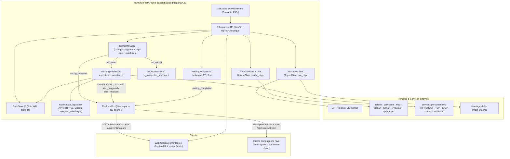

[English](../en/architecture.md) | [Français](architecture.md)

# Architecture technique

`pve-panel` est un centre de commande homelab **FastAPI + React 19** packagé dans un conteneur unique, conçu pour superviser les nœuds Proxmox VE, le stockage MergerFS/SMART, les services multimédias, le moteur d'alertes avec persistance SQLite et l'appairage chiffré des applications compagnons.

---

## 1. Architecture globale du système

---

## 2. Cycle de vie Backend & Clients HTTP

Dans `backend/app/main.py`, le gestionnaire `lifespan` de FastAPI initialise :

1. **`RealtimeBus`** : s'attache à la boucle `asyncio` active pour la diffusion pub/sub (`max_queue_size = 128`, suppression du plus ancien en cas de saturation).
2. **Pools HTTP asynchrones (`httpx.AsyncClient`)** :
   - `app.state.pve_http` : applique `cfg.proxmox.verify_ssl` avec `timeout=httpx.Timeout(5.0, connect=3.0)`. Il est recréé automatiquement si `proxmox.verify_ssl` change via `PUT /api/config/yaml`, `POST /api/onboarding/init` ou `PUT /api/setup/config`.
   - `app.state.media_http` : utilise `verify=False` et `timeout=httpx.Timeout(3.5, connect=2.5)` pour les intégrations homelab internes, connecteurs et webhooks sortants.
3. **`StateStore`** : ouvre la base SQLite (`STATE_DB_PATH`, par défaut `/app/config/state.db` sous Docker) en mode `WAL` avec `PRAGMA synchronous=NORMAL` et `PRAGMA foreign_keys=ON`.
4. **`PairingRelayStore`**, **`NotificationDispatcher`**, **`MDNSPublisher`** et **`AlertEngine`**.
5. **Observateur `ConfigManager`** : lance une tâche `watchfiles.awatch` surveillant `config/config.yaml` (ainsi que `.env` et `services.yaml` en mode synthétisé hérité).

FastAPI sert directement le frontend React 19 compilé depuis `STATIC_DIR` (`/app/static` dans Docker ou `frontend/dist` en local). Les fichiers HTML renvoient `Cache-Control: no-store, no-cache, must-revalidate, max-age=0` afin d'éviter toute interface obsolète en cache après déploiement.

---

## 3. ConfigManager déclaratif & Préservation des secrets

Implémenté dans `backend/app/config_manager.py` et `backend/app/config_schema.py` :

- **Ordre de résolution** :
  - Variable `CONFIG_PATH` -> `/app/config/config.yaml` (si présent ou si `/app` existe) -> `./config/config.yaml`.
  - Si `config.yaml` est absent, `ConfigManager` synthétise un `AppConfig` en mémoire depuis `.env` / `os.environ` et `services.yaml` (`is_synthesized == True`), avec détection des modifications via horodatage `mtime`.
- **Interpolation des variables d'environnement** :
  - Les chaînes contenant `${VAR_NAME}` ou `${VAR_NAME:-default}` sont résolues récursivement à partir de `.env` et `os.environ` (`os.environ` est prioritaire).
- **Masquage des secrets & Préservation des gabarits** :
  - `GET /api/config/yaml` et `GET /api/config/export` remplacent les secrets littéraux par `"********"` tout en laissant visibles les expressions `${VAR_NAME}`.
  - `PUT /api/config/yaml`, `PUT /api/setup/config` et `PUT /api/notifications/channels` préservent les `${VAR_NAME}` et secrets existants lorsque la valeur transmise vaut `"********"` ou est vide.
- **Écriture atomique** :
  - `write_text_safe` écrit dans un fichier temporaire caché dans le répertoire cible, exécute `fsync`, applique les permissions (`0600` à la création de `.env` et `config.yaml`), puis effectue `os.replace` — avec repli en écriture directe `fsync` si un *bind-mount* Docker renvoie `EBUSY`, `EXDEV` ou `EPERM`.

---

## 4. Architecture de sécurité DualAuth

`TailscaleSSOMiddleware` (`backend/app/middleware/tailscale_auth.py`) fonctionne comme un middleware ASGI pur compatible HTTP, SSE `StreamingResponse` et WebSocket :

1. **Extraction du jeton Bearer ou de requête** :
   - Lit `Authorization: Bearer <token>` sur toutes les requêtes HTTP/WS.
   - Pour les WebSockets (`scope["type"] == "websocket"` ou `/api/ws/*`) et SSE (`/api/events/stream`), accepte également `?token=<token>`.
   - Vérifie les jetons en temps constant (`hmac.compare_digest`) contre les hash SHA-256 de `security.api_tokens`, ou valide un JWT HS256 signé avec `effective_session_secret` (`security.session_secret` ou secret éphémère 256 bits).
2. **Évaluation Loopback (`127.0.0.1`, `::1`, `localhost`, `::ffff:127.0.0.1`)** :
   - Si `security.dev_auth_bypass` vaut `true`, authentifie avec le premier utilisateur Tailscale autorisé (ou `dev@localhost`).
   - Si `security.tailscale_sso_enabled` vaut `true`, vérifie l'en-tête `Tailscale-User-Login` injecté par `tailscale serve` contre `security.allowed_tailscale_users` (`401` si absent, `403` si non autorisé).
3. **Exemptions publiques et de premier démarrage** :
   - Toujours publiques : `GET /api/health`, `POST /api/auth/login`, `/api/pairing/*`, `GET /api/onboarding/status`, `/assets/*`, routes statiques SPA hors `/api` (`GET`/`HEAD`), et `POST /api/custom-services/{id}/webhook` (qui contrôle son propre jeton si `auth_type != "none"`).
   - Uniquement avant configuration (`not is_configured()`) : `/api/onboarding/*`, `/api/setup/status`, `/api/setup/test-service`, `/api/setup/config` et `/api/discovery/lan`. Dès que `is_configured()` devient `true`, l'authentification est exigée.

---

## 5. AlertEngine, Connecteurs & StateStore SQLite

`AlertEngine` (`backend/app/services/alert_engine.py`) interroge les `custom_services` actifs selon leur `refresh_interval_seconds` (minimum `5s`) avec verrou `asyncio.Lock` par service :

- **Connecteurs (`backend/app/services/connectors/`)** :
  - `http_rest` : requête HTTP asynchrone `GET`/`HEAD` vérifiant `expected_status` (`200` par défaut, ou `2xx–3xx` si vide), avec authentification `none`, `bearer`, `basic`, `header` et contrôle TLS optionnel.
  - `tcp_port` : connexion socket `asyncio.open_connection(host, port)` et mesure de latence.
  - `icmp_ping` : sous-processus `ping -c 1` gérant macOS (`-W` en ms) et Linux (`-W` en secondes) avec extraction du RTT.
  - `json_metrics` : lecture HTTP JSON et extraction par chemin pointé/indexé (`stats.active_users`, `items[0].state`, ou paires `alias=chemin`).
  - `webhook_ingest` : évalue le dernier heartbeat stocké dans SQLite (table `webhook_heartbeats`) par rapport à `webhook_ttl_seconds`.
- **Machine d'états & Persistance (`backend/app/services/state_store.py`)** :
  - Tables : `service_states`, `incidents`, `webhook_heartbeats`, `apns_devices`.
  - Passe en état `down` et ouvre un incident `critical` uniquement lorsque `consecutive_failures >= threshold` (`alert_policy.consecutive_failures` ou `alerts.default_consecutive_failures`).
  - Bloque les alertes répétitives pendant `cooldown_seconds` ou lorsqu'une fenêtre `muted_until` est active.
  - Clôture automatiquement les incidents ouverts au retour `up` et diffuse `alert_resolved`.
- **Canaux de notification (`backend/app/services/notifications.py`)** :
  - **Discord** : Rich Embeds colorés `#EF4444` (panne), `#F59E0B` (dégradé), `#10B981` (rétablissement).
  - **Telegram** : messages formatés et échappés MarkdownV2 via `https://api.telegram.org/bot<token>/sendMessage`.
  - **Webhook générique** : payload JSON structuré (`event`, `title`, `message`, `severity`, `service_id`, `service_name`, `status`, `latency_ms`, `timestamp`, `incident_id`, `details`) compatible ntfy, Gotify et Home Assistant.
  - **APNs HTTP/2** : signe des JWT ES256 (`iss`, `iat`) avec la clé privée EC `.p8` vers `api.sandbox.push.apple.com` ou `api.push.apple.com`, et nettoie automatiquement les jetons répondant `410`/`Unregistered`.

---

## 6. Temps réel, mDNS & Relais d'appairage chiffré

- **Événements temps réel (`RealtimeBus`)** :
  - Enveloppe JSON : `{"type": "<event_type>", "timestamp": "YYYY-MM-DDTHH:MM:SSZ", "payload": {...}}`.
  - WebSocket (`/api/ws/events`) envoie `{"type": "ping", ...}` toutes les `25s` et accepte `"pong"` ou `{"type": "pong"}`.
  - SSE (`/api/events/stream`) émet un commentaire `: keepalive` toutes les `25s`.
  - Événements diffusés : `config_reloaded`, `service_status_changed`, `alert_triggered`, `alert_resolved`, `incident_acknowledged`, `pairing_completed`.
- **Bonjour / mDNS (`MDNSPublisher`)** :
  - Publie `_pvecenter._tcp.local.` avec les propriétés TXT `id`, `name`, `version`, `port`, `https` et `public_url`.
  - `GET /api/discovery/lan` explore `_pvecenter._tcp.local.`, `_http._tcp.local.`, `_ssh._tcp.local.` et `_smb._tcp.local.` dans une fenêtre bornée (`0.5–4.0s`).
- **Relais d'appairage chiffré (`PairingRelayStore`)** :
  - Conserve en mémoire pendant `300s` des sessions à code PIN 6 chiffres (limitation à `10` échecs par tranche de `60s` par IP cliente).
  - Transmet le bloc chiffré côté client (`P-256 ECDH` + `HKDF-SHA256` + `AES-256-GCM` : `sender_public_key`, `nonce`, `ciphertext`, `tag`) de l'iPhone vers l'Apple TV, émet `pairing_completed` et supprime la session dès sa lecture unique via `GET /api/pairing/sessions/{pin}/payload`.
